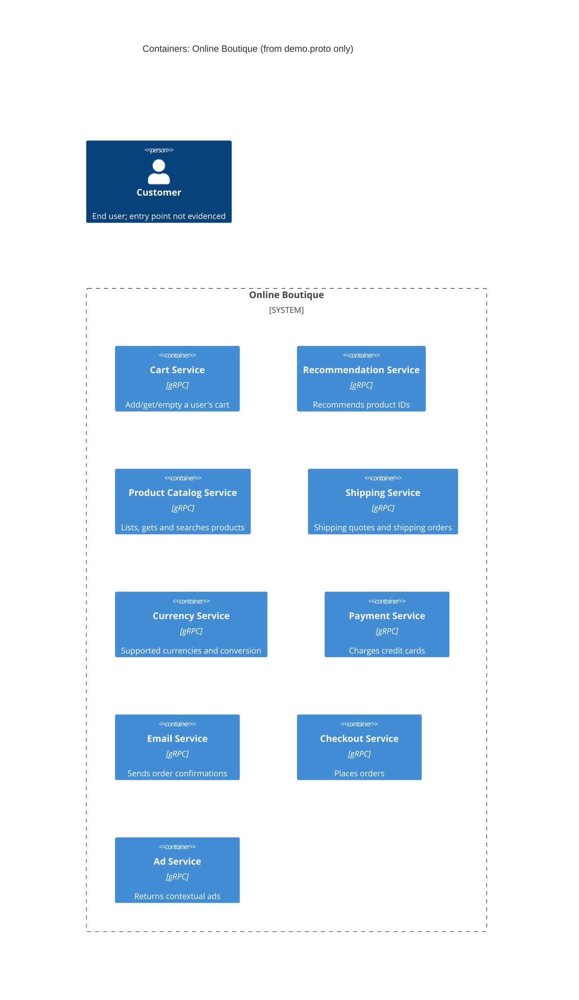

# 1A: Recovered architecture (evidence: `protos/demo.proto` only)

## 1. Agent

Claude Code (Anthropic), model Opus 5.5 (`claude-opus-5-5`).

## 2. Files read

- `prompts/1-recover-architecture.md` (task file)
- `system/online-boutique/protos/demo.proto` (only evidence file)

## 3. Containers table

The proto file declares nine gRPC services in package `hipstershop` (`demo.proto` line 17). It defines interfaces only, so it doesn't show implementation languages, deployment units or data stores.

| Container | Technology / language | Responsibility | Evidence |
|---|---|---|---|
| Cart Service | gRPC (proto3); language not evidenced | Add items to a user's cart, read it, empty it (`AddItem`, `GetCart`, `EmptyCart`) | `system/online-boutique/protos/demo.proto` (`service CartService`, l.23–27) |
| Recommendation Service | gRPC (proto3); language not evidenced | Return recommended product IDs for a user and a list of products (`ListRecommendations`) | `system/online-boutique/protos/demo.proto` (`service RecommendationService`, l.56–58) |
| Product Catalog Service | gRPC (proto3); language not evidenced | List products, get one product, search products (`ListProducts`, `GetProduct`, `SearchProducts`) | `system/online-boutique/protos/demo.proto` (`service ProductCatalogService`, l.71–75) |
| Shipping Service | gRPC (proto3); language not evidenced | Quote shipping cost and ship orders, returning a tracking ID (`GetQuote`, `ShipOrder`) | `system/online-boutique/protos/demo.proto` (`service ShippingService`, l.107–110) |
| Currency Service | gRPC (proto3); language not evidenced | List supported currencies and convert `Money` amounts (`GetSupportedCurrencies`, `Convert`) | `system/online-boutique/protos/demo.proto` (`service CurrencyService`, l.140–143) |
| Payment Service | gRPC (proto3); language not evidenced | Charge a credit card and return a transaction ID (`Charge`) | `system/online-boutique/protos/demo.proto` (`service PaymentService`, l.177–179) |
| Email Service | gRPC (proto3); language not evidenced | Send an order confirmation email (`SendOrderConfirmation`) | `system/online-boutique/protos/demo.proto` (`service EmailService`, l.199–201) |
| Checkout Service | gRPC (proto3); language not evidenced | Place an order for a user, returning an `OrderResult` (`PlaceOrder`) | `system/online-boutique/protos/demo.proto` (`service CheckoutService`, l.224–226) |
| Ad Service | gRPC (proto3); language not evidenced | Return ads for a set of context keywords (`GetAds`) | `system/online-boutique/protos/demo.proto` (`service AdService`, l.243–245) |

Data stores: Not evidenced in the provided files.

## 4. Dependencies table

A `.proto` file declares which RPCs each service **offers**. It doesn't declare which service **calls** which, so the evidence shows no runtime caller → callee dependency.

| Caller → callee | Protocol | Evidence |
|---|---|---|
| None evidenced | – | Not evidenced in the provided files |

Shared message types (e.g. `Money`, `Address`, `CartItem`, `CreditCardInfo`) show schema coupling between the service interfaces, not runtime calls. Likely calls are listed under **Gaps**.

## 5. Mermaid diagram

The diagram has no `Rel` lines because the dependencies table is empty. The `Person` is there because the diagram convention requires it. The evidence doesn't show the end user or how they reach the system.

## 6. Gaps

| Gap | Why it's unresolved | File that would settle it |
|---|---|---|
| Who calls whom (all runtime dependencies) | A proto defines the servers' interfaces, not their clients | `system/online-boutique/kubernetes-manifests/*.yaml` (`*_SERVICE_ADDR` env vars), or each service's client code under `system/online-boutique/src/` |
| **[Inferred]** `checkoutservice` → cart, product catalog, currency, shipping, payment, email | `PlaceOrderRequest` (l.228–235) carries `user_id`, `user_currency`, `address`, `email`, `credit_card`, and `OrderResult` (l.208–214) holds a shipping tracking ID and costs. Both point to these calls, but neither proves them | `system/online-boutique/src/checkoutservice/` source, `kubernetes-manifests/checkoutservice.yaml` |
| **[Inferred]** `recommendationservice` → product catalog | `ListRecommendationsRequest` takes `product_ids` (l.60–63). The service might look up the catalog, but that isn't shown | `system/online-boutique/src/recommendationservice/` source, `kubernetes-manifests/recommendationservice.yaml` |
| Web frontend / entry point and the user's protocol (e.g. HTTP) | No frontend service appears in the proto | `system/online-boutique/kubernetes-manifests/frontend.yaml`, `src/frontend/` |
| Data stores (e.g. where carts are kept) | The proto has no storage details | `kubernetes-manifests/` (e.g. a cache/database deployment), `src/cartservice/` config |
| Implementation language of each service | A proto is language-neutral (only `go_package`, l.19, appears) | `src/*/Dockerfile` or the source trees |
| Containers not exposed via gRPC (e.g. load generator) | Only gRPC services appear in the proto | `kubernetes-manifests/` |
| External systems (real payment provider, mail server) | Not evidenced in the provided files | `src/paymentservice/`, `src/emailservice/` source |
