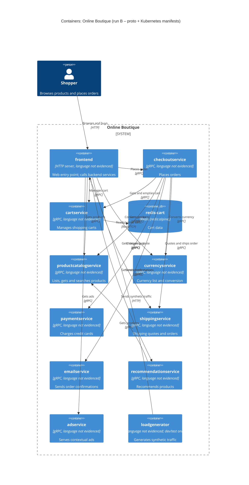

# Task 1 – Recovered architecture (run B)

## 1. Agent

Claude Code (Anthropic), model Claude Opus 5.5 (`claude-opus-5-5`).

## 2. Files read

- `prompts/1-recover-architecture.md` (task file)
- `system/online-boutique/protos/demo.proto`
- `system/online-boutique/kubernetes-manifests/README.md`
- `system/online-boutique/kubernetes-manifests/kustomization.yaml`
- `system/online-boutique/kubernetes-manifests/adservice.yaml`
- `system/online-boutique/kubernetes-manifests/cartservice.yaml`
- `system/online-boutique/kubernetes-manifests/checkoutservice.yaml`
- `system/online-boutique/kubernetes-manifests/currencyservice.yaml`
- `system/online-boutique/kubernetes-manifests/emailservice.yaml`
- `system/online-boutique/kubernetes-manifests/frontend.yaml`
- `system/online-boutique/kubernetes-manifests/loadgenerator.yaml`
- `system/online-boutique/kubernetes-manifests/paymentservice.yaml`
- `system/online-boutique/kubernetes-manifests/productcatalogservice.yaml`
- `system/online-boutique/kubernetes-manifests/recommendationservice.yaml`
- `system/online-boutique/kubernetes-manifests/shippingservice.yaml`

## 3. Containers table

Implementation language is **not evidenced** for any service: the manifests only give bare image names (e.g. `image: frontend`), and `demo.proto` is language-neutral. "gRPC server" below is evidenced by Service port name `grpc` and `grpc:` readiness/liveness probes.

| Container | Technology / language | Responsibility | Evidence |
|---|---|---|---|
| `frontend` | HTTP server on :8080, exposed via `LoadBalancer` on :80; language not evidenced | Web entry point for shoppers; calls the backend services | `kubernetes-manifests/frontend.yaml` (Service `frontend-external` `type: LoadBalancer`; `httpGet` probe `/_healthz`; `*_SERVICE_ADDR` env) |
| `checkoutservice` | gRPC server :5050; language not evidenced | Places orders (`PlaceOrder`) | `kubernetes-manifests/checkoutservice.yaml` (Service port `grpc` 5050); `protos/demo.proto` (`service CheckoutService`) |
| `cartservice` | gRPC server :7070; language not evidenced | Add item / get / empty a user's cart | `kubernetes-manifests/cartservice.yaml` (Service port `grpc` 7070); `protos/demo.proto` (`service CartService`) |
| `redis-cart` | Redis (`redis:alpine`), :6379, `emptyDir` volume | Cart data store | `kubernetes-manifests/cartservice.yaml` (Deployment `redis-cart`, `image: redis:alpine`, volume `redis-data: emptyDir`) |
| `productcatalogservice` | gRPC server :3550; language not evidenced | List / get / search products | `kubernetes-manifests/productcatalogservice.yaml` (Service port `grpc` 3550); `protos/demo.proto` (`service ProductCatalogService`) |
| `currencyservice` | gRPC server :7000; language not evidenced | Supported currencies and money conversion | `kubernetes-manifests/currencyservice.yaml` (Service port `grpc` 7000); `protos/demo.proto` (`service CurrencyService`) |
| `paymentservice` | gRPC server :50051; language not evidenced | Charges a credit card (`Charge`) | `kubernetes-manifests/paymentservice.yaml` (Service port `grpc` 50051); `protos/demo.proto` (`service PaymentService`) |
| `shippingservice` | gRPC server :50051; language not evidenced | Shipping quotes and shipping orders | `kubernetes-manifests/shippingservice.yaml` (Service port `grpc` 50051); `protos/demo.proto` (`service ShippingService`) |
| `emailservice` | gRPC server (Service :5000 → container :8080); language not evidenced | Sends order confirmation (`SendOrderConfirmation`) | `kubernetes-manifests/emailservice.yaml` (Service port `grpc` 5000, `targetPort: 8080`); `protos/demo.proto` (`service EmailService`) |
| `recommendationservice` | gRPC server :8080; language not evidenced | Recommends product IDs (`ListRecommendations`) | `kubernetes-manifests/recommendationservice.yaml` (Service port `grpc` 8080); `protos/demo.proto` (`service RecommendationService`) |
| `adservice` | gRPC server :9555; language not evidenced | Returns ads for context keywords (`GetAds`) | `kubernetes-manifests/adservice.yaml` (Service port `grpc` 9555); `protos/demo.proto` (`service AdService`) |
| `loadgenerator` | No Service/port; language not evidenced | Generates synthetic user traffic (`USERS: 10`, `RATE: 1`). Dev/test only: commented out in `kustomization.yaml` | `kubernetes-manifests/loadgenerator.yaml` (env `FRONTEND_ADDR`, `USERS`, `RATE`); `kubernetes-manifests/kustomization.yaml` (`# - loadgenerator.yaml`) |

## 4. Dependencies table

The protocol for service→service calls comes from the callee's Service port name `grpc` plus its `service` definition in `demo.proto`.

| Caller → Callee | Protocol | Evidence |
|---|---|---|
| Shopper → `frontend` | HTTP (port 80) | `kubernetes-manifests/frontend.yaml` (Service `frontend-external`, `type: LoadBalancer`, port name `http`) |
| `frontend` → `productcatalogservice` | gRPC | `kubernetes-manifests/frontend.yaml` (`PRODUCT_CATALOG_SERVICE_ADDR=productcatalogservice:3550`) |
| `frontend` → `currencyservice` | gRPC | `kubernetes-manifests/frontend.yaml` (`CURRENCY_SERVICE_ADDR=currencyservice:7000`) |
| `frontend` → `cartservice` | gRPC | `kubernetes-manifests/frontend.yaml` (`CART_SERVICE_ADDR=cartservice:7070`) |
| `frontend` → `recommendationservice` | gRPC | `kubernetes-manifests/frontend.yaml` (`RECOMMENDATION_SERVICE_ADDR=recommendationservice:8080`) |
| `frontend` → `shippingservice` | gRPC | `kubernetes-manifests/frontend.yaml` (`SHIPPING_SERVICE_ADDR=shippingservice:50051`) |
| `frontend` → `checkoutservice` | gRPC | `kubernetes-manifests/frontend.yaml` (`CHECKOUT_SERVICE_ADDR=checkoutservice:5050`) |
| `frontend` → `adservice` | gRPC | `kubernetes-manifests/frontend.yaml` (`AD_SERVICE_ADDR=adservice:9555`) |
| `checkoutservice` → `productcatalogservice` | gRPC | `kubernetes-manifests/checkoutservice.yaml` (`PRODUCT_CATALOG_SERVICE_ADDR`) |
| `checkoutservice` → `shippingservice` | gRPC | `kubernetes-manifests/checkoutservice.yaml` (`SHIPPING_SERVICE_ADDR`) |
| `checkoutservice` → `paymentservice` | gRPC | `kubernetes-manifests/checkoutservice.yaml` (`PAYMENT_SERVICE_ADDR=paymentservice:50051`) |
| `checkoutservice` → `emailservice` | gRPC | `kubernetes-manifests/checkoutservice.yaml` (`EMAIL_SERVICE_ADDR=emailservice:5000`) |
| `checkoutservice` → `currencyservice` | gRPC | `kubernetes-manifests/checkoutservice.yaml` (`CURRENCY_SERVICE_ADDR`) |
| `checkoutservice` → `cartservice` | gRPC | `kubernetes-manifests/checkoutservice.yaml` (`CART_SERVICE_ADDR`) |
| `recommendationservice` → `productcatalogservice` | gRPC | `kubernetes-manifests/recommendationservice.yaml` (`PRODUCT_CATALOG_SERVICE_ADDR`) |
| `cartservice` → `redis-cart` | Redis protocol (TCP 6379) | `kubernetes-manifests/cartservice.yaml` (`REDIS_ADDR=redis-cart:6379`; Service port name `tcp-redis`) |
| `loadgenerator` → `frontend` | HTTP | `kubernetes-manifests/loadgenerator.yaml` (`FRONTEND_ADDR=frontend:80`; init container `wget http://${FRONTEND_ADDR}`) |

## 5. Mermaid diagram

## 6. Gaps

| Gap | Why it's open | File(s) that would settle it |
|---|---|---|
| Implementation language/framework of each service | Manifests only give bare image names (`image: frontend`, …) and `README.md` says the tags are filled in by `skaffold` | Each service's `Dockerfile` / source under `system/online-boutique/src/<service>/`; `skaffold.yaml` |
| Which RPCs each caller actually invokes (e.g. does `frontend` call `ShippingService.GetQuote` only, or `ShipOrder` too?) | Env vars show *that* a caller has an address, not which methods it uses. The `Rel` labels are **[Inferred]** from RPC names in `demo.proto` | Caller source code (e.g. `src/frontend/`, `src/checkoutservice/`) |
| Whether every configured address is really used at runtime | An `*_ADDR` env var is strong but indirect evidence of a call | Caller source code |
| `shoppingassistantservice` | `frontend.yaml` sets `SHOPPING_ASSISTANT_SERVICE_ADDR=shoppingassistantservice:80`, but there is no manifest for it in this folder, `ENABLE_ASSISTANT` is commented out, and it isn't in `demo.proto`. Left out of the diagram | `kustomize/components/shopping-assistant/` (referenced, commented out, in `kustomization.yaml`); frontend source |
| Packaging service | Only a commented-out `PACKAGING_SERVICE_URL` in `frontend.yaml` ("optional Google Cloud demo") | Frontend source; any optional-component docs |
| External systems: a real payment gateway, an SMTP/email provider, a currency rates source | Not evidenced in the provided files: no external hosts or credentials in the manifests. No `System_Ext` is drawn | Source of `paymentservice`, `emailservice`, `currencyservice` |
| Where the product catalog data comes from (file, DB, …) | `productcatalogservice.yaml` has no DB address or volume | `src/productcatalogservice/` source; `kustomize/components/alloydb` / `spanner` |
| Cart storage alternatives and durability | `redis-cart` uses `emptyDir` (data is lost when the pod is deleted). Commented components `memorystore`, `alloydb`, `spanner` suggest alternative stores **[Inferred]** | `kustomize/components/memorystore/`, `alloydb/`, `spanner/` |
| Security / network policy between services | `network-policies` component is commented out; no mTLS config seen (only an Istio probe annotation on `frontend` and `loadgenerator`) | `kustomize/components/network-policies/`; Istio manifests, if any |
| Observability backends (tracing/metrics/profiling) | Only `ENABLE_PROFILER` / `DISABLE_PROFILER` flags; no collector container | `kustomize/components/google-cloud-operations/`; service source |
| Is `loadgenerator` part of the production system? | It is in the folder but commented out of `kustomization.yaml` ("During development … skaffold"). Shown in the diagram as dev/test only | `skaffold.yaml` |
