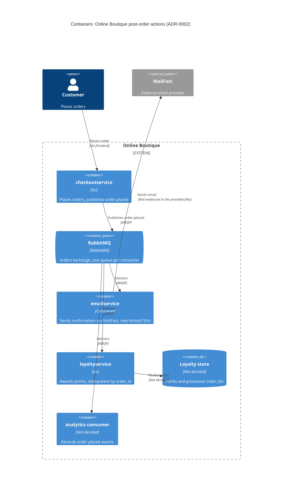

> Agent: Claude Code — Model: Claude Opus 5.5 (`claude-opus-5-5`)

# ADR-0002: Publish an "order placed" event to RabbitMQ for post-order actions

- **Status:** Proposed
- **Date:** 2026-10-27
- **Deciders:** ทีมพัฒนา Online Boutique (4 developers) — ร่างโดย AI agent ต้องให้ทีมยืนยัน

## Context and problem

Requirement R-12 (`docs/scenario.md`) กำหนดว่าหลังจาก order ถูกสร้างแล้ว ระบบต้อง (1) ส่ง email ยืนยันผ่าน **MailFast** (external provider) แทน logic mock ของ `emailservice` (2) ให้ loyalty points ผ่าน `loyaltyservice` ตัวใหม่ (3) บันทึก analytics event "order placed" และปีหน้าจะมี post-order action เพิ่ม (SMS, fraud scoring, recommendations update)

**ระบบปัจจุบัน (จากโค้ด):**

| ข้อเท็จจริง | หลักฐาน |
|---|---|
| `PlaceOrder` เรียก `paymentservice` → `shippingservice` → `cartservice` (EmptyCart) → `emailservice` แบบ synchronous gRPC ตามลำดับ | `system/online-boutique/src/checkoutservice/main.go` (`PlaceOrder`, บรรทัด 252–277) |
| ถ้าส่ง email ล้มเหลว จะแค่ log warning และ order ยังสำเร็จ | `main.go` บรรทัด 273–277 |
| การเรียก `SendOrderConfirmation` ใช้ `ctx` ของ request โดยไม่มี timeout แยกในไฟล์นี้ ดังนั้น latency ของ email ถูกบวกเข้ากับ `PlaceOrder` โดยตรง | `main.go` (`sendOrderConfirmation`, บรรทัด 379–384) |
| dependency ทุกตัวถูกผูกผ่าน env var + gRPC connection ใน struct `checkoutService`; การเพิ่ม action ใหม่ = แก้ struct, `main()` และ `PlaceOrder` ทุกครั้ง | `main.go` (`checkoutService` บรรทัด 66–86, `mustMapEnv`/`mustConnGRPC` บรรทัด 111–123) |
| `checkoutservice` ไม่มี data store ของตัวเอง (มีแต่ gRPC connection) | `main.go` (`checkoutService` struct) |

**ตัวเลขที่สำคัญ (`docs/scenario.md`):**

| หัวข้อ | ค่า | ผลต่อการตัดสินใจ |
|---|---|---|
| `PlaceOrder` p95 | ≤ 500 ms (ปัจจุบัน ~300 ms) | เหลือ budget ~200 ms เท่านั้น |
| MailFast | p95 1.5 s, p99 8 s, fail ~0.5 %, rate limit 50 emails/s | เรียกแบบ synchronous ใน `PlaceOrder` จะทำให้ p95 เกิน 500 ms แน่นอน |
| Peak load | 200 orders/s (11.11) | 200 > 50 → email ค้าง backlog สะสม **150 emails/s ≈ 9,000 emails ต่อนาทีของ peak** ต้องมี buffer |
| Loyalty points | ภายใน 1 นาที, **exactly once** | ต้องมี retry + idempotency |
| Availability | order ต้อง **ไม่ fail** เพราะ email/loyalty/analytics ล่ม | post-order action ต้องแยกออกจาก critical path |
| Team / Ops | 4 devs ถนัด Go + gRPC; 2 คนเคยใช้ **RabbitMQ**; รันบน Kubernetes; ชอบ open-source self-hosted | เอื้อต่อ RabbitMQ in-cluster |

**ปัญหา:** จะเชื่อม `checkoutservice` กับ post-order action ทั้งหลายอย่างไร ให้ checkout เร็วและไม่ล้มตาม downstream, รองรับ rate limit ของ MailFast, ให้ points แบบ exactly once และเพิ่ม action ใหม่ได้ง่าย

## Decision drivers

1. **Availability:** order ต้องไม่ fail เมื่อ MailFast, `loyaltyservice` หรือ analytics ล่ม
2. **Performance:** `PlaceOrder` p95 ≤ 500 ms ที่ 200 orders/s
3. **Reliability / correctness:** loyalty points ภายใน 1 นาที และ exactly once; email ต้องไม่หายเมื่อ MailFast fail 0.5 % หรือติด rate limit 50/s
4. **Modifiability:** เพิ่ม SMS, fraud scoring, recommendations ปีหน้าได้โดยไม่ต้องแก้ `checkoutservice`
5. **Cost / operability:** open-source self-hosted บน Kubernetes, ทีมเล็ก 4 คน ใช้ทักษะที่มีอยู่

## Considered options

1. **Synchronous gRPC fan-out** — ขยาย `PlaceOrder` ให้เรียก MailFast, `loyaltyservice`, analytics ต่อจาก `emailservice` เหมือนเดิม
2. **In-process async (goroutines)** — `PlaceOrder` ตอบกลับทันทีแล้วยิง action แต่ละอันใน goroutine ภายใน `checkoutservice`
3. **Event-driven ด้วย RabbitMQ (self-hosted)** — `checkoutservice` publish event `order.placed` ไปยัง exchange; consumer แต่ละตัว (`emailservice` → MailFast, `loyaltyservice`, analytics) มี queue ของตัวเอง
4. **Event-driven ด้วย Apache Kafka (self-hosted)** — แนวคิดเดียวกับข้อ 3 แต่ใช้ Kafka topic + consumer groups

### Pros and cons of the options

| Option | Pros | Cons |
|---|---|---|
| 1. Sync gRPC fan-out | ง่ายสุด; ตรงกับ pattern เดิมและทักษะ Go/gRPC; ไม่มี component ใหม่ | MailFast p95 1.5 s ทำให้ p95 เกิน 500 ms; 200/s ชน rate limit 50/s; downstream ช้า/ล่ม = checkout ช้า; ทุก action ใหม่ต้องแก้ `PlaceOrder` (coupling สูง) |
| 2. In-process goroutines | latency ต่ำ; ไม่มี infra ใหม่ | งานค้างอยู่ใน memory หายเมื่อ pod restart; ไม่มี durable retry → ไม่รับประกัน points ภายใน 1 นาที/exactly once; rate limit 50/s ต้องคุมข้าม replica เอง; ยังต้องแก้ `checkoutservice` ทุก action ใหม่ |
| 3. RabbitMQ | ตัด downstream ออกจาก critical path; queue durable เป็น buffer ให้ backlog email ระหว่าง peak; consumer คุม rate 50/s ได้เอง; retry + dead-letter queue; เพิ่ม action ใหม่ = bind queue ใหม่ ไม่ต้องแก้ checkout; open-source, รันบน Kubernetes; ทีม 2 คนเคยใช้ | component stateful ใหม่ต้องดูแล (HA, monitoring); delivery เป็น at-least-once → `loyaltyservice` ต้อง dedupe เอง; publish ยังเป็น dual-write (ดู Risks); ไม่มี replay ย้อนหลังแบบ log |
| 4. Kafka | throughput สูง; เก็บ event เป็น log และ replay ได้ (ดีกับ analytics/recommendations); open-source | ทีมไม่มีประสบการณ์ (ไม่ระบุใน scenario); operate ยากกว่าสำหรับทีม 4 คน; ยังต้อง dedupe ฝั่ง consumer; 200 events/s ไม่ต้องการ throughput ระดับ Kafka |

## Decision

เลือก **Option 3: RabbitMQ (self-hosted บน Kubernetes)** เพราะตอบ driver 1–4 ได้ครบ และตรงกับ driver 5 (open-source, ทีมมีประสบการณ์) มากกว่า Kafka

รายละเอียด:

- **Publish:** ใน `PlaceOrder` แทนที่การเรียก `sendOrderConfirmation` (`main.go` บรรทัด 273–277) ด้วยการ publish event `order.placed` ไปยัง topic exchange (เช่น `orders`) แบบ persistent พร้อม publisher confirms และ timeout สั้น ถ้า publish ล้มเหลว **ต้องไม่ทำให้ order fail** (คง behaviour เดิมที่แค่ log) payload มี `order_id`, `user_id`, `email`, items, total และ `occurred_at` (ข้อมูลเหล่านี้มีอยู่แล้วใน `PlaceOrder`: `orderID`, `req.UserId`, `req.Email`, `orderResult`, `total`)
- **Email:** `emailservice` กลายเป็น consumer ของ queue `email.order-placed` เรียก MailFast ด้วย rate limiter รวม ≤ 50 emails/s, retry ด้วย exponential backoff สำหรับ 0.5 % ที่ fail, ส่งเข้า dead-letter queue เมื่อเกินจำนวน retry ที่กำหนด ด้วย Little's law ต้องมี in-flight request ≈ 50 × 1.5 s ≈ 75 ตัวเพื่อให้ได้ 50/s (มากกว่านั้นเมื่อเจอ p99 8 s)
- **Loyalty:** `loyaltyservice` (Go) consume queue `loyalty.order-placed`, ใช้ `order_id` เป็น idempotency key (unique constraint ใน store ของตัวเอง) แล้ว ack หลังบันทึกสำเร็จ → at-least-once delivery + idempotent consumer = ผลลัพธ์ exactly once
- **Analytics:** consumer ของ queue `analytics.order-placed` บันทึก event
- **อนาคต:** SMS / fraud scoring / recommendations = queue ใหม่ bind กับ exchange เดิม ไม่ต้องแก้ `checkoutservice`

## Consequences

- **Positive:** `PlaceOrder` ไม่ต้องรอ MailFast (p95 1.5 s / p99 8 s) อีกต่อไป เหลือแค่ต้นทุน publish ไป broker in-cluster (quality attribute: performance)
- **Positive:** MailFast, `loyaltyservice` หรือ analytics ล่ม ไม่ทำให้ order fail; message รออยู่ใน queue จนกว่า consumer กลับมา (quality attribute: availability)
- **Positive:** queue รองรับ backlog 150 emails/s ระหว่าง peak และระบายตาม rate limit 50/s; retry + DLQ ลดการสูญหายของ email (quality attribute: reliability)
- **Positive:** action ใหม่ปีหน้าเพิ่มได้ด้วยการเพิ่ม consumer ไม่ต้องแตะ checkout (quality attribute: modifiability)
- **Negative:** มี component stateful ใหม่ (RabbitMQ cluster) ต้อง deploy, monitor, upgrade ด้วยทีม 4 คน (quality attribute: operability / cost)
- **Negative:** email ไม่ได้ส่งทันทีอีกต่อไป ระหว่าง peak ลูกค้าอาจได้ email ช้าเป็นนาทีหรือมากกว่า (quality attribute: performance จากมุมผู้ใช้ / usability)
- **Negative:** ระบบเป็น eventually consistent และ debug ยากขึ้นข้าม async boundary; ต้อง propagate trace context ผ่าน message header (โค้ดปัจจุบันใช้ OpenTelemetry กับ gRPC อยู่แล้ว: `main.go` บรรทัด 134–140) (quality attribute: observability)
- **Risks and mitigations:**
  - **Dual-write / event หาย:** ถ้า broker ล่มตอน publish order ต้องสำเร็จ แต่ event อาจหาย → ไม่มี email/points. Mitigation: RabbitMQ แบบ quorum queues หลาย replica; retry publish แบบ bounded ภายใน latency budget; ทางที่แข็งแรงกว่าคือ transactional outbox แต่ `checkoutservice` ยังไม่มี data store (`main.go`, struct `checkoutService`) → ดู Open questions
  - **Points ซ้ำ:** redelivery ของ RabbitMQ → idempotency key `order_id` + unique constraint ใน `loyaltyservice`
  - **Points เกิน 1 นาที:** queue ของ loyalty แยกจาก email จึงไม่ติด backlog ของ MailFast; ตั้ง alert เมื่อ message age ใน `loyalty.order-placed` > 30 s
  - **Backlog email ไม่หมด:** ถ้า peak นานมาก backlog โตไม่จำกัด → monitor queue depth, กำหนด max length / TTL ตาม policy ที่ตกลงกับ marketing
  - **Poison message:** ใช้ dead-letter queue + alert

## Validation

- **Load test** ด้วย `loadgenerator` (Locust) ที่ 200 orders/s: ตรวจว่า `PlaceOrder` p95 ≤ 500 ms
- **Chaos test:** ปิด `emailservice`, `loyaltyservice`, analytics consumer และจำลอง MailFast fail/ช้า (p99 8 s) → อัตรา order สำเร็จต้องไม่ลดลง
- **Loyalty correctness:** ส่ง message ซ้ำ (redelivery/consumer restart) แล้วตรวจว่า points ถูกให้ครั้งเดียวต่อ `order_id`; วัด lag ระหว่าง `occurred_at` กับเวลาที่บันทึก points ต้อง ≤ 1 นาทีที่ peak
- **Metrics ใน production:** queue depth และ message age ต่อ queue, จำนวนใน DLQ, MailFast send rate (≤ 50/s), publish failure rate ของ `checkoutservice`
- **Review date:** ทบทวน ADR นี้หลัง 11.11 sale และก่อนเพิ่ม action ใหม่ (SMS, fraud scoring) [วันที่ต้องยืนยันกับทีม]

## Open questions

- **ระยะเวลา peak 11.11:** ไม่ระบุ จำเป็นต่อการประเมินขนาด backlog email (9,000 emails ต่อนาทีของ peak) และเวลาที่ใช้ระบายหมด
- **SLA ของ email:** ลูกค้าต้องได้ email ภายในกี่นาที? ยอมรับ delay ระหว่าง peak ได้แค่ไหน? MailFast เพิ่ม rate limit ได้หรือไม่?
- **Fraud scoring:** ถ้าต้องตัดสินก่อนยืนยัน order จะเป็น synchronous ไม่ใช่ post-order event — ต้องยืนยันกับ marketing
- **Protocol/API ของ MailFast** และรองรับ idempotency key หรือไม่ (เพื่อกัน email ซ้ำเมื่อ retry): Not evidenced in the provided files
- **Data store ของ `loyaltyservice`** และของ analytics (marketing ใช้เครื่องมืออะไร): ไม่ระบุ
- **Event สูญหายยอมรับได้แค่ไหน?** ถ้าไม่ได้เลย ต้องเพิ่ม data store ให้ `checkoutservice` เพื่อทำ transactional outbox — ต้องตัดสินแยก
- **Latency ของการ publish ไป RabbitMQ in-cluster** พร้อม publisher confirms: ไม่มีตัวเลข ต้องวัดจาก load test
- **ใครดูแล RabbitMQ** (on-call, backup, upgrade) และใช้ operator ตัวใด: ไม่ระบุ
- **Deciders** และ review date ที่แน่นอน: ไม่ระบุ
